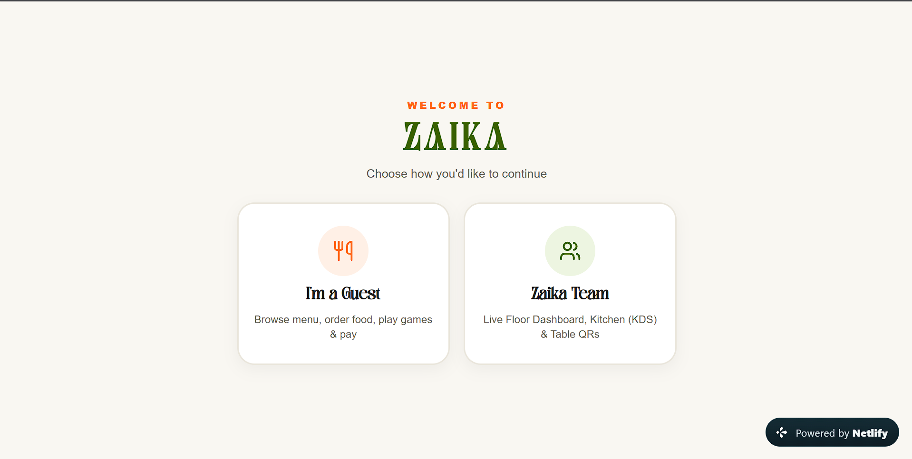
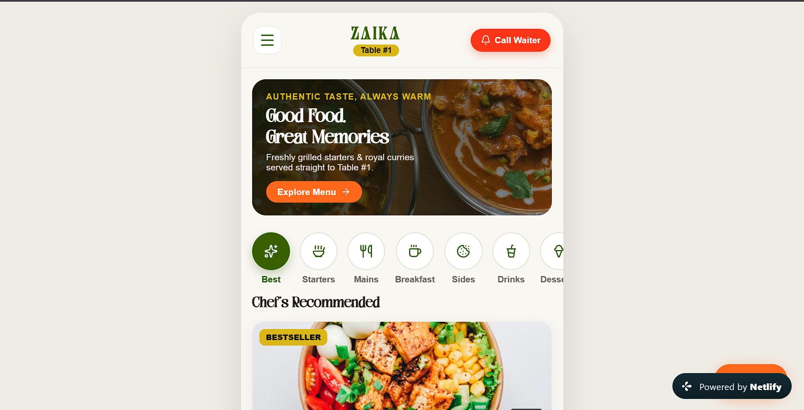
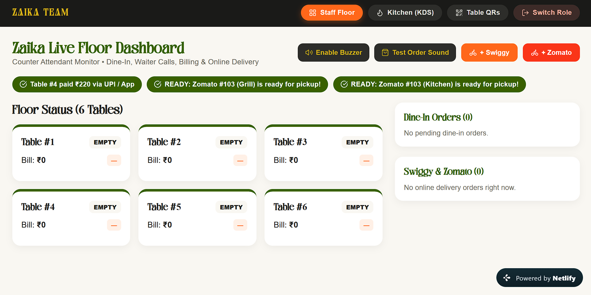
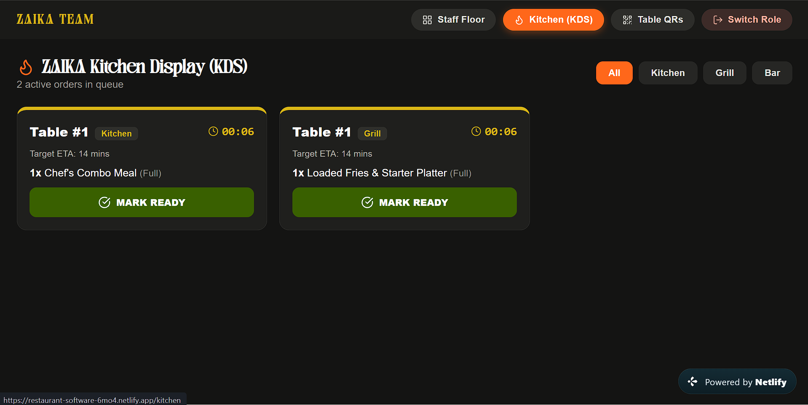
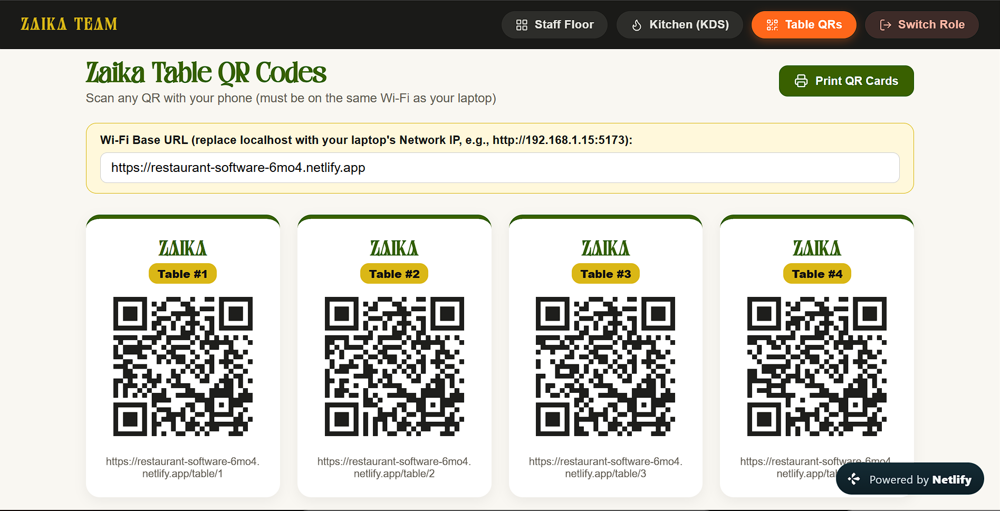

# 🍽️ Zaika — Full-Stack Restaurant OS

A modern, real-time restaurant management web application built with **React (Vite)**, **Node.js**, **Express**, and **Socket.io**. Features QR code table menus, live customer ordering, a Staff Floor Dashboard, and a Kitchen Display System (KDS).

---

## 🌐 Live Demo

View the live application:

👉 **[Zaika Restaurant OS Live](https://restaurant-software-6mo4.netlify.app/)**

* **Guest Menu (Table 1):** [Open Table #1](https://restaurant-software-6mo4.netlify.app/table/1)
* **Staff Floor Dashboard:** [Open Staff Floor](https://restaurant-software-6mo4.netlify.app/staff)
* **Kitchen Display (KDS):** [Open KDS](https://restaurant-software-6mo4.netlify.app/kds)
* **Table QR Generator:** [Open QR Codes](https://restaurant-software-6mo4.netlify.app/qr)

---

## 📸 Project Preview

### Welcome Screen


### Customer QR Menu & Ordering


### Live Staff Floor Dashboard


### Kitchen Display System (KDS)


### Permanent Table QR Code Generator


---

## ✨ Key Features

* **QR Code Table Ordering:** Guests scan a table-specific QR code to browse the menu and place orders directly from their phone.
* **Real-Time Sync:** Powered by Socket.io for instant order notifications, live table status updates, and audio alerts.
* **Staff Floor Dashboard:** Monitor all tables, dine-in orders, billing, waiter calls, and Swiggy/Zomato orders in one place.
* **Kitchen Display System (KDS):** Live order queue for kitchen staff to track and update preparation status.
* **Printable QR Cards:** Built-in generator to print permanent QR cards for every table.

---

## 🛠️ Tech Stack

### Frontend
* React (Vite)
* CSS3 / Modern Responsive UI
* Socket.io Client

### Backend
* Node.js
* Express.js
* Socket.io

### Deployment
* **Frontend:** Netlify
* **Backend:** Railway

---

## ⚙️ Installation

### Clone the repository
```bash
git clone [https://github.com/adi-tech-01/RESTAURANT-SOFTWARE.git](https://github.com/adi-tech-01/RESTAURANT-SOFTWARE.git)
cd RESTAURANT-SOFTWARE
